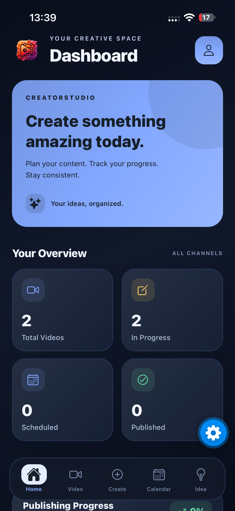
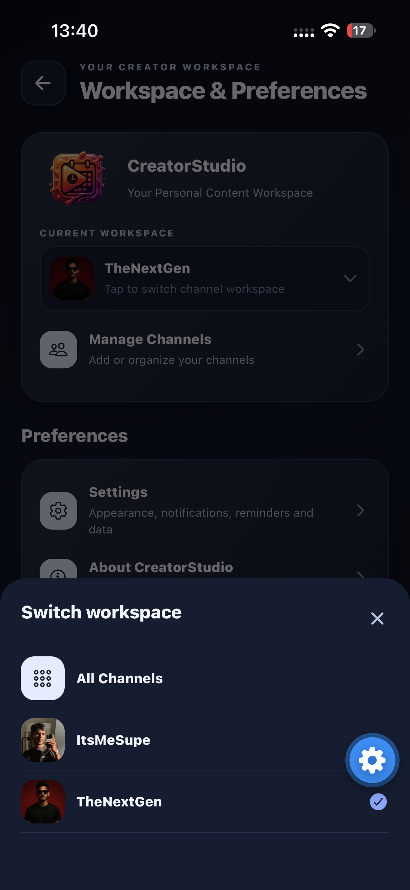

# CreatorStudio – Your Personal Content Workspace

CreatorStudio is a mobile application designed to help content creators organize, manage, and track their content creation activities in one place.

Creating content involves more than just recording and publishing videos. Creators also need to manage ideas, plan upcoming content, write descriptions, track editing progress, and remember publishing schedules. Managing all these activities across different platforms can become difficult.

CreatorStudio aims to make this process easier by bringing these essential activities together in one organized workspace.

## ✨ Features

- **Multiple Channel Management:** Create and manage multiple content channels within a single workspace.
- **Video Project Management:** Create, update, and organize video projects with descriptions, thumbnails, priorities, and planned publishing dates.
- **Content Idea Vault:** Save, categorize, and organize creative ideas for future content.
- **Task Management:** Break down video production into manageable editing tasks and track their progress.
- **Content Workflow Tracking:** Follow the video production process from Idea to Planning, Editing, Ready to Publish, and Published.
- **Calendar & Scheduling:** View planned content and keep track of upcoming publishing dates.
- **Dashboard & Analytics:** Get an overview of video projects, tasks, and content progress using locally stored application data.
- **Reminders & Notifications:** Receive local reminders for planned publishing activities.
- **Multiple Themes & Customization:** Choose from several built-in themes and personalize the application with custom colors, HEX color values, typography, and appearance settings.
- **Backup & Restore:** Export and restore supported project data.
- **Offline Access:** Manage content without requiring a constant internet connection.

## 🎨 UI & User Experience

CreatorStudio focuses on providing a modern, visually appealing, and user-friendly experience. The application includes several design options that allow users to personalize the interface according to their preferences.

- **Multiple Built-in Themes:** Comes with several ready-to-use themes, including Apple Liquid Glass and Liquid Glass Aurora.
- **Theme Selection:** Users can easily switch between available themes.
- **Custom Color Options:** Personalize the interface using custom colors and HEX color values.
- **Light & Dark Modes:** Choose between Light, Dark, and System appearance modes.
- **Typography Customization:** Customize the visual appearance of text throughout the application.
- **Modern Glassmorphism UI:** Features a clean and modern interface with glass-inspired design elements.
- **User-Friendly Navigation:** Provides five main navigation sections for easy access to application features.

## 🛠️ Technologies Used

| Technology | Purpose |
|---|---|
| JavaScript | Main programming language |
| React Native | Mobile application development |
| Expo SDK 58 | Development and application tooling |
| SQLite | Local database management |
| React Navigation | Screen navigation |
| Expo Notifications | Local notifications and reminders |
| Expo Image Picker | Selecting images from the device |
| Git & GitHub | Version control and project management |

## 🏗️ Application Architecture

CreatorStudio follows a modular structure to keep the application organized and easier to maintain.

- **Screens:** Handle the application's main pages and user interactions.
- **Components:** Provide reusable UI elements.
- **Context:** Manage shared application state, workspace information, and preferences.
- **Database:** Handle SQLite database initialization and data storage.
- **Repositories:** Manage database operations for channels, videos, tasks, ideas, and settings.
- **Services:** Handle supporting functionality such as notifications.
- **Navigation:** Manage movement between application screens.

## 📱 Main Application Sections

CreatorStudio provides five main navigation sections:

1. **Home:** View the workspace dashboard and an overview of content activities.
2. **Videos:** Browse and manage video projects.
3. **Create:** Start creating new video projects.
4. **Calendar:** View and organize planned publishing schedules.
5. **Ideas:** Save and manage content ideas.

Additional options, including profile, settings, theme customization, and backup management, are available within the application.

## 💾 Offline-First Data Management

CreatorStudio is designed as an offline-first application, allowing users to manage their content projects without depending on cloud services or a continuous internet connection.

- **Local SQLite Database:** Stores application data directly on the device.
- **Offline Access:** Create, organize, and manage content projects without an internet connection.
- **Local Data Management:** Keeps channels, videos, tasks, and other supported information within the application.

## 🔄 Backup & Restore

Since CreatorStudio stores data locally, it includes backup and restore functionality to help users protect and transfer supported application data.

- **Export Backup:** Export supported project data as a backup.
- **Restore Data:** Restore supported data from a previously created backup.
- **Data Portability:** Helps users move supported project information between installations.

*Note: The current backup functionality covers channels, videos, tasks, and their relationships. Ideas, application settings, and image binary files are not included in the current backup.*

## 📱 Application Screenshots

Explore the CreatorStudio application through the screenshots below.

<table>
  <tr>
    <td align="center" width="25%"><strong>01. Loading Page</strong> </td>
    <td align="center" width="25%"><strong>02. Home Page</strong> </td>
    <td align="center" width="25%"><strong>03. Dashboard</strong> </td>
    <td align="center" width="25%"><strong>04. Workspace</strong> </td>
  </tr>
  <tr><td colspan="4" height="18"></td></tr>
  <tr>
    <td align="center" width="25%"><strong>05. Manage Channels</strong> </td>
    <td align="center" width="25%"><strong>06. Video Page</strong> </td>
    <td align="center" width="25%"><strong>07. Create Project</strong> </td>
    <td align="center" width="25%"><strong>08. Idea Vault</strong> </td>
  </tr>
  <tr><td colspan="4" height="18"></td></tr>
  <tr>
    <td align="center" width="25%"><strong>09. Content Calendar</strong> </td>
    <td align="center" width="25%"><strong>10. App Theme</strong> </td>
    <td align="center" width="25%"><strong>11. App Theme 2</strong> </td>
    <td align="center" width="25%"><strong>12. Backup &amp; Restore</strong> </td>
  </tr>
</table>
